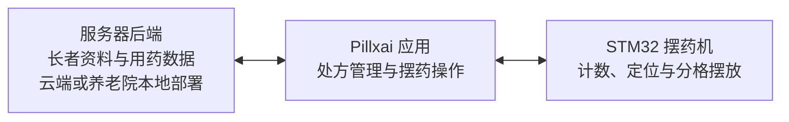

<h1 align="center">Pillxai</h1>

  
  
  
  

<strong>面向养老院与社区护理场景的智能摆药系统。</strong>

Pillxai 由摆药机、Pillxai 应用和服务器后端组成，帮助护士与护工根据长者的用药安排，为未来多天准备多种药物。工作人员按提示投入当前药物，机器完成计数与分格摆放，多余药片从回收口返回。

[项目背景](#项目背景) · [工作方式](#工作方式) · [下载](#下载) · [设置](#设置) · [开发进展](#开发进展) · [后续规划](#后续规划) · [合作与交流](#合作与交流)

本项目为**上海交通大学交互研究所项目**，软件由本仓库维护者负责原创设计、开发与维护。硬件目前不开源。

我们通过这个仓库分享项目设计、软件进展与护理场景中的实践，希望与关注养老护理、智能硬件和软件产品的**合作者及投资者**建立联系，共同推进研发与应用。

## 项目背景

根据项目团队的现场了解，由家属送药是上海养老院较常见的用药管理模式，送到院内的药物按长者分别存放。

我们走访的上海某养老院约有 600 位长者，大部分有用药需求，一位长者可能同时需要七八种甚至更多药物。

护士从每位长者的储药格取出药物，在桌旁打开药盒，对照手边的用药清单，逐一剥出药片，再放入对应的早、午、晚药格。剥药片和按照个人用药安排逐格摆放，是其中最耗时的两步。

Pillxai 聚焦于计数与分格摆放这一步。护士仍负责从包装中取出药物、按提示投料，以及需要时预先切好半片；机器将药片分配到相应日期与服药时段的药格。项目在多家养老院测试，并获得多项奖项。

## 工作方式

1. **查看待摆清单。** 在应用中查看当天需要处理的长者，选择本次摆药对象。
2. **核对用药安排。** 应用提示该长者需要的药物、数量、服药时段及本次准备日期。
3. **放入配套药盒。** 将对应长者的药盒放入机器，完成核验并开始摆药。
4. **按提示逐药投料。** 工作人员投入当前药物，无需预先精确数出本次所需粒数。机器自动计数并放入对应药格，多余药片从回收口返回。
5. **依次完成并取盒。** 根据应用提示更换药物，直至完成本次安排，再取出药盒。

药盒以一个方向表示日期，另一个方向表示早、午、晚等服药时段；睡前时段可按需启用。

## 药物与药盒

现有硬件可分发常规大小的药物，支持整片和人工预切的半片。半片由护士事先切好后投入，机器不承担切药或剥药工作。

| 药盒 | 组织方式 |
| --- | --- |
| 养老院三格药盒 | 适配两种三格盒型，每七个组成一组，按日期与早、午、晚安排药物 |
| 居家四格药盒 | 4 × 7，共 28 格，可安排七天及每天四个服药时段 |

## 系统组成

- **摆药机**：由 STM32 驱动，执行药片计数、药盒定位与分格摆放。现有设备通过 HC-06 经典蓝牙串口与终端连接。
- **Pillxai 应用**：面向护士与护工，提供长者与处方管理、待摆清单、用药提示和摆药操作。当前维护版本采用 Flutter，生产首发目标为 Android 平板。
- **服务器后端**：负责保存长者资料与用药数据，当前技术方向为 Python + FastAPI。部署设计提供云服务和养老院本地服务器两种选择，方便机构按数据隐私与运维需求决定数据存放位置。

## 开发进展

软件目前进入第三个版本：

| 版本 | 应用框架 |
| --- | --- |
| 第一版 | PyQt |
| 第二版 | Unity |
| 第三版（当前维护） | Flutter |

Flutter 新版本的开发进展（`NT` 开发分支）：

- 已建立处方管理、摆药与设置的交互界面；默认入口现已接入真实登录、长者与处方保存、用药版本；当前不提供账号管理界面。
- 已建立 FastAPI/PostgreSQL 基础服务、生成式 Dart API 客户端、独立设备协议模块与 Windows 工程联调入口，并完成基础软件验证。
- 本机资料链路已通过 SDK 和浏览器到数据库的验证。生产摆药任务、后台运行及完整设备流程仍在实施与验收中；演示执行只在显式测试模式提供。
- 既有硬件使用与早期院内测试，不代表 Flutter 新版本已经完成生产或实机验收。

## 下载

| 组件 | 下载 |
| --- | --- |
| Android 客户端 | 待发布 |
| 服务器发行包 | 待发布 |

## 设置

### 1. 运行服务器

可选择云服务器或养老院本地服务器。此处预留环境准备、安装、数据初始化、启动和服务地址配置说明。

### 2. 客户端连接服务器

此处预留客户端填写服务器地址、登录账号及检查连接的操作说明，随客户端配置功能完善后补充。

### 3. 客户端连接摆药机

目标连接方式为客户端所在终端通过 HC-06 蓝牙串口直连 STM32 摆药机。此处预留设备配对、应用内连接与首次试运行说明，随实机联调完成后补充。

## 后续规划

围绕药物准备、居家使用与护理服药环节，项目还计划推进以下方向：

- **剥药机**：减少从药品包装中逐粒取出药片的人工操作，衔接摆药前的准备工作。
- **家用药盒智能底座**：为居家药盒提供服药提醒与服药记录功能。
- **护工服药提醒与记录 App**：提醒护工给长者服药，并记录服药情况。

## 合作与交流

欢迎感兴趣的合作者和投资者了解项目，并围绕以下方向交流：

- **技术研发**：软件、硬件与交互设计，推动摆药系统及后续产品的研发。
- **场景应用**：结合养老院、社区与居家护理需求，开展使用研究、测试和应用合作。
- **商业与投资**：探讨产品化、部署服务与项目的长期发展。

合作、投资与商业授权咨询：[jiale.ma@sjtu.edu.cn](mailto:jiale.ma@sjtu.edu.cn)。

## 许可与开放范围

软件以 **源码可见（Source Available）** 方式提供，采用项目自定义的 [Pillxai 非商业源码许可](LICENSE)，授权方为 **Pillxai 项目团队**。

- **非商业用途**：依照许可条款，可免费使用、修改与再分发。
- **商业用途**：须事先取得项目团队另行提供的书面许可，请联系 [jiale.ma@sjtu.edu.cn](mailto:jiale.ma@sjtu.edu.cn)。
- **硬件与第三方内容**：硬件目前不开源；第三方依赖与素材遵循各自许可。

## 鸣谢

感谢以下机构：

- **上海闵行海鸥养老院**
- **上海江川路敬老院**
