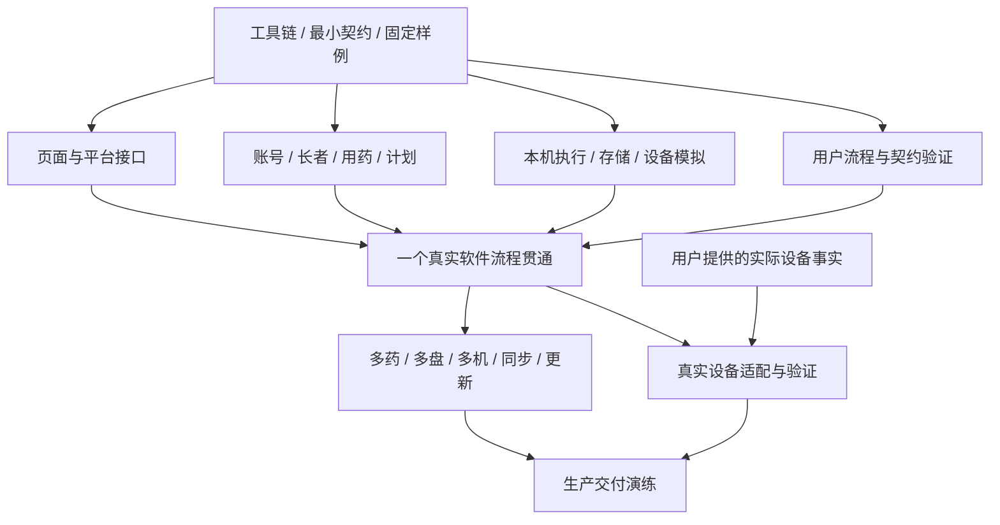

# Pillxai Dispenser Agent 协作与实施路线

更新日期：2026 年 10 月 26 日。用户确认当前 UI 阶段完成，进入完整新版本开发，采用 Flutter + Python/FastAPI，保持模块化和前后端分离。生产首发 Android 平板直连 HC-06；开发服务先在同机 WSL/Conda 部署，今天优先以 Windows 电脑连接 HC-06 蓝牙串口联调。默认界面已接入真实账号、长者/处方和版本；NT 分支已运行 M0 基础切片及 M1 资料切片，现已补充通用设置保存和服务端计划预览；M2 归属/启动许可、完整任务覆盖及 Windows 本机执行已通过双盘模拟，Android 前台服务/RFCOMM 已实现并通过 Android 15 模拟器后台、双盘补传与恢复验证（见 [Android 报告](validation/2026-10-27-android.md)），实体平板已实测单药 28 颗、FINISH 与学习参数保存，取盒自动释放及完整现场验收仍待完成，见 [执行报告](validation/2026-10-26-execution.md)。本文件第 6–12 节为当前执行计划，第 13 节为本轮实际检查；客户端已有验证见[客户端说明](../apps/client/README.md)。架构责任以 [08](08-system-architecture.md)为准，计划与测试目标不作为完成证据。

## 1. 以完成工作衡量开发

本轮 M0–M6 聚焦当前摆药系统；[00 中的后续产品规划](00-scope-and-defaults.md#后续产品规划)，包括剥药机、家用药盒智能底座及护工服药提醒与记录 App，另行制定实施与验收计划。

开发的目标是让工作人员在生产环境完成真实摆药工作，并能维护资料、查询结果和更新软件。不同 Agent 可以采取不同实现，强模型可以提出并验证更好的方案。

评估一项实现时依次看：

1. 用户确认的业务目标是否完成，设备事实是否真实。
2. 工作人员能否顺利操作，常见中断后能否继续处理。
3. 数据归属、数量、版本和历史能否解释。
4. 代码责任与依赖是否清楚，替换和扩展是否局部可做。
5. 构建、验证、安装与发布是否可重复。

代码必须可读且精简：名称说明业务含义，模块责任集中，依赖直接可查；只引入有实际复用或替换需求的抽象，不为减少行数压缩表达。UI 保留用户已认可的低信息密度与三个入口侧边栏，当前按 06 的颜色、品牌、组件与平板比例要求实现可操作的 Flutter 界面。当前以用户确认的极简风格作为唯一界面，移除底部方案切换栏与其他方案。后续沿用这套视觉语言完善处方管理、摆药与设置，不继续保留多方案比较入口。用户提供的原型和参考图继续保留。

默认按钮、目录、库和操作组合是起点。Agent 可以调整，说明对用户结果的改善，直接修改相关文档和验证。对真实业务含义的改变需要用户输入；普通技术选择由 Agent 自主完成。

## 2. 给 Agent 一个明确入口

根目录 AGENTS.md 提供短入口，docs/README.md 提供文档地图。业务权威内容在 00–07，架构和实施路线在 08–09。90–92 保存历史来源；本次确认的参数与学习规则统一在 04，日常实现直接读取该规则，不从历史附录推导另一套定义。

用户要求不修改其电脑的系统环境，已授权项目目录内的工具链、依赖和缓存安装，无需逐项申请。使用现有工具或仓库内显式路径；构建环境变量仅在本次进程中配置并恢复。全局工具、全局 PATH、注册表、驱动、系统配置和服务变更仍须先获批准。

每个模块在实现时维护简短 README：责任、公开入口、依赖、拥有的数据、运行方式、相关案例和当前限制。复杂模块可有局部 AGENTS.md，仅补充该模块实际需要的开发约定。

背景材料按任务提供：长者功能使用长者与识别规则，执行功能使用设备能力与状态规则。避免每项小任务都加载整个仓库，也允许能处理大范围任务的模型读完整上下文。

独立重写不以 legacy 中的结构、库、类、表和页面作为设计起点。2026-10-27 用户仅授权核查 V1 参数设置与学习规则，并确认先沿用这些规则，依据汇入 04；不迁移旧已学习数据、不复用旧实现。其他未明确的机器使用事实仍向用户提出具体问题，硬件工作可先使用语义模拟器。

## 3. 并行的基础是公开边界

并行开发以可运行契约和独立验证入口为支点：

- HTTP 契约由 FastAPI 公开模型生成至 contracts/http；本机命令与事件在执行核心公开入口统一定义，平台桥接不另建业务状态模型。
- 页面依赖生成的 SDK、平台接口和可运行模拟。
- 后端业务模块有公开入口及真实存储验证。
- 设备执行依赖语义设备接口和可重放反馈轨迹。
- 跨边界的固定样例放在 tests/fixtures，包含业务输入、期望结果及来源。

Agent 可以在对方功能尚未完成时开发自己的完整切片。早期就把模拟替换成真实协作验证；模拟接口与实际接口使用相同契约。



图中节点代表依赖，并非固定团队人数。一位更强 Agent 可以完成多个节点，多位 Agent 也可以在一个大节点中按清晰责任分工。

## 4. 推荐的并行工作线

| 工作线 | 独立交付物 | 主要协作边界 |
| --- | --- | --- |
| 契约与工程 | 单一 API 契约、Dart SDK 生成、工作区、统一命令和依赖检查 | FastAPI/OpenAPI 生成验证、契约版本与生成物 |
| 业务后端 | 人员、长者、用药、计划和任务归属 | API、公开模块入口、SQL 迁移 |
| 产品界面 | 工作台、用药维护、计划、执行及查询体验 | API SDK、平台接口、本机快照 |
| 本机执行 | 状态转换、本地存储、Android 后台执行、补传与模拟设备 | 平台接口、执行接口、设备语义 |
| 数据与交付 | 查询、采样、PDF、安装、发布与更新 | 已保存事实、作业与发布契约 |
| 集成验证 | 跨语言样例、完整工作流程、多机及持续运行 | 可运行软件与验收结果 |

协调 Agent 负责当前目标、依赖、接口变更和集成结果，不替所有工作线编写内部代码。实现与验证可由不同 Agent 交叉检查；最终以可复现的运行结果判断完成。

## 5. 任务包

任务使用用户能识别的目标命名，例如“工作人员暂停后继续同一药物”，而不是只写“实现暂停接口”。任务包记录：

```text
目标：工作人员要完成什么
输入：相关规则、契约版本、固定样例、已有模块状态
负责范围：本任务通常修改的模块及协作对象
结果：正常流程、失败或中断时用户能看到什么
验证：运行入口、覆盖的验收案例、所需真实环境
交接：公开入口变化、生成物、迁移、已知未完成项
```

文件范围用于减少同时改写同一处，不禁止必要的跨模块完成工作。需要改变共享契约时先将新的输入输出同步给相关工作线，再合入兼容实现；可以在同一任务内完成连贯变更。

并行任务使用独立分支或工作区。共享锁文件、根工程配置和生成入口由当前负责工程整合的任务统一更新；各模块拥有自己的源文件与迁移片段。迁移使用唯一名称，集成时统一确定执行顺序，避免多人争抢连续编号。

每次集成重新生成契约和数据库类型，运行受影响验证。任务完成报告给出实际结果、验证方法及未解决内容，不以代码量、Agent 数量或阅读了多少文件作为进度。

## 6. 本轮执行范围与依赖

计划日期：2026 年 10 月 26 日。用户确认当前 UI 开发阶段完成，下一步实现完整新版本，保持模块化与前后端分离。第一版服务在同一电脑的 WSL/Conda 内部署测试，允许模拟机；今天实机使用 **Windows 电脑 → HC-06 蓝牙出站串口 → STM32**。Android 平板仍是生产首发目标，Windows 是本轮提前验证硬件的入口。

优先交付两个可并行的结果：**真实长者/处方保存读取**，以及**今天可运行的 Windows 设备联调入口**。第一条完整软件流程随后将中央计划、本机执行、模拟反馈和记录补传接起来。今天不承诺完整生产版或 Android 实机验收完成；按下述可运行阶段推进，不以估计工时替代通过证据。

~~~mermaid
flowchart LR
  M0["M0 环境、契约、模块入口"] --> M1["M1 真实账号、长者和处方"]
  M1 --> M2["M2 中央计划、领取与启动许可"]
  M0 --> M3["M3 本机持久执行与模拟机"]
  M0 --> W0["W0 Windows 串口联调"]
  M2 --> M4["M4 第一条完整流程"]
  M3 --> M4
  W0 --> Real["M4 实机替换验收"]
  M4 --> Real
  Real --> M5["M5 完整业务与 Android 实机"]
  M5 --> M6["M6 多机与生产交付"]
~~~

W0 只依赖设备接口、协议和本地日志的最小入口，不等待 M1–M2。M3 与 M1–M2 并行。M4 的软件验收先使用模拟机；真实设备部分按 W0 已确认的能力逐项替换。Android 服务宿主的技术验证在 M0/M3 提前进行，完整平板实测不晚于 M5。

## 7. 模块与依赖方向

权威责任定义见 [08](08-system-architecture.md)。下列目录按阶段建立：当前已有基础、identity/residents/prescriptions 和客户端数据模块，planning/tasks 已实现计划、任务及执行事实；附件、PDF 等完整业务仍待后续实施；不提前堆空目录。

| 位置 | 交付职责 | 允许依赖 |
| --- | --- | --- |
| apps/client | 沿用现有 UI；登录、资料、计划、执行与历史接入 | 生成的 API 客户端、本机执行公开接口 |
| apps/api/src/pillxai_api | identity、residents、prescriptions、planning、tasks、records 等业务模块 | 后端业务入口、数据库及附件存储 |
| apps/api/migrations | 数据库结构与数据升级 | 后端存储定义，不向前端导出 ORM |
| packages/api_client | 自动生成的 Dart API 客户端 | 导出的 OpenAPI，不手改生成物 |
| packages/execution_core | 状态机、命令阶段、任务快照、允许操作与设备语义接口 | 纯 Dart；注入设备、存储、时钟、上传 |
| packages/device_protocol | STM32 编解码、字节流拆包、反馈转换 | 已确认设备协议和执行公开事件 |
| packages/device_runtime | Windows 串口、Android 蓝牙/USB、生命周期宿主、本地 SQLite 与上传适配 | 执行核心、协议、平台能力、API 客户端 |
| tools/device_probe | Windows 开发联调入口，复用生产协议及传输 | 执行/设备模块，不生成生产覆盖 |
| tests/fixtures | 计划、协议帧、事件轨迹和预期结果 | 虚构资料及获准保存的实机轨迹 |
| contracts/http | 导出的 OpenAPI 与兼容样例 | 唯一源为 FastAPI 公开模型 |
| scripts | Windows 与 WSL 的启动、生成、验证入口 | 项目内显式工具路径 |

界面不直连数据库，不拼串口报文，不计算另一套生产可执行计划。中央服务不连接 COM、不经网络逐颗驱动机器。执行核心不导入页面；页面切换只改变订阅。每个设备会话串行推进，Windows 宿主、Android 服务与 UI 不能各自维护一份权威执行状态。

后端模块公开 DTO 与 ORM 分开；跨模块用例调用明确的业务入口，并在需要时共享一个事务。初期使用一个 FastAPI 服务和一个 PostgreSQL 数据库，不为模块化拆成微服务。数据库事务、约束及版本校验共同保障对象关系、任务领取和重复请求处理。

## 8. 契约、配置与资料规则

### 8.1 单一契约

- HTTP：FastAPI 的公开请求/响应模型 → OpenAPI 导出 → Dart SDK 生成。错误码、冲突版本、分页、日期、时区、枚举、可空值均进入契约。
- 剂量采用明确的精确表示，计划颗粒使用整数；用共享样例验证半片换算，不能依赖跨语言浮点碰巧一致。
- 本机操作与事件以 execution_core 的公开类型为唯一源；平台桥接仅承载所需连接、字节流与生命周期能力，生成绑定时不再维护另一份业务状态枚举。
- 每次改变公开接口，先更新源定义和固定样例，再重新生成并运行契约检查；在 M0 验证生成器确实支持所需类型。
- 中央身份至少关联长者、处方条目/版本、计划、任务、批次、设备、终端和人员。业务请求、事件使用稳定身份支持重试；不假称 STM32 回传了它没有携带的任务编号。

### 8.2 配置和运行模式

API 地址由构建/启动配置传入，默认同机开发服务；设备模式在装配入口选择模拟或真实适配器，不在各页面散落判断。同一活跃任务不能切换模拟/实机或更换连接。正式运行构建不提供固定计划绕过启动许可的调试入口。

模拟数据、工程联调数据和正式业务数据使用分开的运行配置及存储范围。工程轨迹标明 simulator/hardware、平台、构建版本及设备身份。HTTP 明文仅限本机开发配置；正式服务使用 HTTPS。账号与密钥不写入源文件和轨迹，现 UI 演示密码不作为正式默认账号。

### 8.3 同机 WSL/Conda 部署

采用现有 Ubuntu-24.04 和 Miniforge 的显式路径启动项目环境，不改变全局 PATH、不运行 conda init、不升级现有其他项目环境。现有 pillbox-backend 只用于环境盘点；依赖不足时在仓库 .tools/conda 下建立独立项目环境，Conda/Pip 缓存也留在 .tools。环境描述与精确锁定结果入库，环境本体不入库。

API 基线为 FastAPI + PostgreSQL + SQLAlchemy/Alembic；本机执行存储为 SQLite。M0 锁定经验证的 Python 和包版本，不把现有环境版本直接当作最终生产选择。数据库按独立进程启动，使用项目配置与数据目录，不注册系统服务；不因部署方便跳过任务事务和并发验证。

仓库当前位于 /mnt/c/Users/jiale/Workspace/Pillxai-Dispener，文件系统检查为 v9fs。先验证项目数据目录的权限、数据库初始化、事务落盘和重启；若不能满足 PostgreSQL 要求，再提出具体的 WSL 原生项目数据目录调整，不修改全局挂载配置或静默写到其他项目。PostgreSQL 对数据目录权限有明确要求，见[官方说明](https://www.postgresql.org/docs/current/creating-cluster.html)。

Windows 首先验证可经 localhost 访问 WSL API；端口在 M0 检查占用后固定，开发约定优先使用 API 8000、数据库 5432。数据库不对局域网开放。后续平板可先使用 USB 调试端口转发，再单独验证局域网；需要防火墙、端口代理或 WSL 网络配置变更时按根目录授权要求处理。网络机制参见 [WSL 官方说明](https://learn.microsoft.com/windows/wsl/networking)；项目路径环境参见 [Conda 官方说明](https://docs.conda.io/projects/conda/en/stable/user-guide/tasks/manage-environments.html)。

## 9. 分阶段任务与完成条件

2026-10-28 新增 V2 服务器并行部署工作：用户要求在新分支 `codex/v2-server-deployment` 实施，使用现有学校 Runner 和独立 Docker/PostgreSQL 部署，不替换 V1。部署入口见 [V2 说明](../deploy/v2-server/README.md)，本轮运行及上线状态见 [部署验证](validation/2026-10-28-v2-deployment.md)。此工作推进服务交付，不能替代 M5 完整业务与 M6 负载、备份副本、实机及工作人员验收。

当前已在 NT 分支完成 M0 的首个基础切片：WSL API/PostgreSQL、契约生成与真实 HTTP 验证、独立协议/Windows 联调/SQLite 诊断。W0 工具入口可用，但真实串口尚未打开。M1 真实资料切片已实现并验证登录、权限、长者/处方版本及现有表单接入；现已完成设置、M2 任务归属、M3 Windows 宿主与 M4 双盘模拟闭环；Android 宿主已完成模拟器切片，实体平板、药品目录复用、异常人工补齐及 M5–M6 完整交付仍待实施。下面的完整阶段目标不能当作全部已完成。实际证据见 [M0 验证报告](validation/2026-10-26-m0.md)。

| 阶段 | 用户目标、输入与依赖 | 交付内容 | 完成证据 |
| --- | --- | --- | --- |
| M0 基础入口 | 能独立启动、调用和测试各模块；依据 03/08 | 项目 Conda 环境、数据库迁移、API 健康检查、第一条生成式契约；执行/模拟公开入口；Windows 串口依赖与 Android 服务宿主最小验证 | Windows 调用 WSL API 成功；空数据库迁移与重启读回；SDK 可重新生成无漂移；一份固定事件经本机落盘可恢复；版本与命令记录齐全 |
| W0 今天的实机入口 | Windows 与 HC-06 双向通信；依据 04，依赖 M0 的设备最小入口 | 独立联调工具、当前出站 COM 选择、原始收发轨迹、单药协议验证 | 按第 10 节逐项记录实际结果；不把端口打开当作机器执行通过 |
| M1 真实资料 | 工作人员登录本院并维护长者与处方；依赖 M0 | 账号认证、账号权限、长者/药品/处方及版本保存，接入现有表单和列表 | 客户端及后端重启不丢；未授权写入拒绝；床位与剂量校验；并发保存返回冲突；停用及恢复留历史（A04、A39、A46、A64–65、A79） |
| M2 计划与归属 | 同院多个终端准备任务且不重复摆药；依赖 M1 | 后端计划、日期/颗粒/分盘快照，任务领取与启动许可；最小新 RFID 绑定、长者归属查询与任务识别上下文；确认页显示服务端计划 | 半片、有效日期、1–7 天、睡前、餐食分盘样例准确；两终端争抢仅一方成功；错人/过期识别不能开始；重叠安排受控；未开始计划过期，已开始快照不变（A09、A18、A37、A41、A73、A80–82、A96–97） |
| M3 本机执行 | 已开始任务独立于页面运行，事实可恢复；与 M1/M2 并行 | 执行状态机、SQLite、事件及待上传队列、模拟器、协议适配；Windows 宿主，Android 服务宿主验证 | 启动意图先落盘；事件与上传项同事务；暂停/恢复/跳过按反馈推进；重复、缺失、迟到与断联可解释；重启进入核对，不自动发矩阵（A24–26、A29–31、A81、A86） |
| M4 第一条完整流程 | 工作人员从资料到结果走通；依赖 M1–M3 | 登录→处方→中央计划→领取/识别→一药执行→取盒→历史；先模拟，后接 W0 实机适配 | 前端/API/本机真实通信与存储；已开始任务断网可完成，新任务受限；重连补传去重；修改处方不改旧快照；有效离轨/就绪才释放占用（A18、A33–34、A46、A94） |
| M5 完整业务及平板 | 工作人员连续处理真实日常任务；依赖 M4 | 多药自动接替、多盘重新识别、异常及人工确认；完整 PDF 标签/扫码与 RFID 绑定管理、附件、独立参数与历史查询；Android 连接/服务/保存 | 多药多盘与跳过不伪造覆盖；显式结束不记录和删除重试符合 R12；参数不跨处方、过时回传不覆盖新值；平板切后台、锁屏、强杀恢复分别实测（A66–69、A74–78、A87–92、A101–107） |
| M6 生产交付 | 工作人员独立使用，开发者可维护 | 云端与养老院本地服务器两种部署分别验收、HTTPS、200 人/6 会话负载、备份恢复、正式签名包、手动安装升级与失败恢复 | 按 07 的 N01–N05 验证 8 小时运行、权限、响应与对账；普通工作人员演练；首次安装及带未上传结果升级；中央恢复与本机补传（A70–72、A83–85、A95） |

M1 接入完成的功能不再依赖 DemoModel；M2 接入后生产计划只有后端一个计算入口；M3/M4 接入后计数与任务推进来自执行模块。迁移按功能逐段替换，演示样例保留为测试输入，不能混入正式运行。现有视觉回归与三尺寸关键交互继续验证，不重新设计界面。

首个完整流程只用一位长者、一种药以缩短反馈，但数据模型从开始保留多药、多盘和独立条目身份。M4 的模拟 UID 与实机 UID 使用 M2 建立的新绑定和同一归属核验入口，不直接注入“已匹配”来代替识别校验；完整标签与扫码体验在 M5 扩展。每个切片必须能实际运行，不能只完成一批接口后等待全部模块一次性集成。

## 10. 今天的 Windows 实机测试安排

优先顺序为 W1 → W2 → W3 → W4；W5 在生产启动链具备后进行。今天先交付独立 Dart 联调入口，调用相同的执行/协议/Windows 串口模块；Flutter Windows UI 能构建后复用这些入口接入。Web 预览不提供 Windows COM 能力，后端完成程度不阻塞 W1–W4。

| 步骤 | 要做什么 | 前置条件与验收 |
| --- | --- | --- |
| W1 连接与记录 | 核对当前 HC-06 配对身份和出站 COM；连接、监听、断开；保存原始字节及文本 | 当前端口重新确认，不沿用历史 COM7；连接不自动发开仓、复位或矩阵。分别记录打开端口、收到反馈；无反馈不能判定波特率错误 |
| W2 双向命令 | 在现场具备条件时逐项验证停转、退出、开仓的 ACK/DONE 与实际动作；验证拆包/粘包 | 沿用 04 已确认的 115200、8N1、无流控；发送二进制，连接过程不改 HC-06 波特率或发 AT 配置。超时进入未知，不自动重发有物理影响的命令 |
| W3 单药执行 | 用单非零位置的小计划核对行列与日期；核对参数→矩阵、累计计数、FINISH、暂停恢复 | 参数初值按 04 已确认基线，并验证实际动作与位置；固定计划只属联调，不生成长者生产结果。暂停恢复保留计数且不重发矩阵；累计达到目标不代替 FINISH |
| W4 中断与取盒事实 | 分别观察蓝牙断联、重新连接、程序重启；采集在轨、离轨、收仓及就绪反馈 | 不把断网、断蓝牙、系统终止合为一种故障；重新连接不自动恢复。先确认现场处置方式，再测失联行为。缺反馈或无法关联时保留未知，不能释放占用 |
| W5 正式流程接入 | 使用后端计划与任务，经正式识别、开始许可、本地落盘，再执行实机一药流程 | 必须 M2/M3 具备；完成与取盒分开，记录同步后可查。联调工具的固定计划不能成为正式页面的旁路 |

今日优先补齐的设备事实：

- 当前出站 COM 与稳定设备身份；不能凭端口排序自动选择。
- 离轨/在轨和就绪的具体报文、收仓触发与完成依据；未明确则自动取盒不能算实机通过。
- 各盒型实体列方向、协议行到物理时段的映射与第四行动作；现有 4 × 7 药盒能力由用户确认，Flutter 新适配仍须逐位置实测，未明确的位置不进入对应正式矩阵。
- 计数的起点与重置时机，ACK/DONE/FINISH 时序和重复/迟到行为；无任务号的归属歧义须如实保留。
- 04 已确认初值和学习规则在实体机器上的表现，以及断联、程序终止后的实际行为；规则确认与模拟结果不替代实机验收。

测试用新建虚构资料和独立联调轨迹。每次结果记录平台、构建号、设备身份、连接位置、配置、操作、预期/实际、原始收发与结论（通过/失败/未测）。Windows 通过只证明该连接与设备事实；Android 蓝牙权限、前台服务、锁屏和后台仍须在平板独立验收。

## 11. 模拟、异常与集成验收

模拟器实现与真实设备相同的语义接口；另外用字节流样例测试真实协议解析器。场景至少覆盖正常完成、暂停恢复、缺 ACK、重复/倒退计数、迟到 FINISH、设备复位、断联、身份冲突、过期识别、收仓失败及离轨/就绪恢复。模拟器可提供确定的事件身份供测试，但不能令真实适配器获得硬件未提供的身份信息。

必须贯通的关键约束：

1. 首次矩阵之前，中央已确认本机归属及启动阶段，本地已保存完整快照与启动意图；任一步结果不明进入恢复核对。
2. 命令写出、ACK、DONE、FINISH、业务完成分别保存；超时不等于没执行，不能盲重发矩阵。
3. 设备事件、状态变化及待上传事实原子落盘，中央幂等接收后才确认同步。网络恢复只补传事实，不触发硬件动作。
4. 本机重启恢复原任务与设备归属；未知现场不得自动继续，也不按超时释放给其他机器。
5. 处方、计划与结果独立留存。正常完成、机器累计、人工确认、跳过和未知分别保存；不把累计量分配为逐格实测。
6. 药物处理结束回首页，取盒阶段仍占用设备；当前有效的离轨/就绪反馈才允许释放，未知和失败继续保留。
7. 普通结束与 R12 显式“结束此次分药（不记录）”分开。删除流程可重试，迟到上传不能重建已删除任务，撤销该任务产生的覆盖；控制删除阶段不承载被要求删除的业务内容。
8. 参数只属于原处方药物条目；旧版本或旧半片结果补传保存历史，不覆盖新形态当前值。参数与学习按 04 的 V1 基线实现：上位机设初速度，STM32 负责批次内调速，正常完成且满足条件后才学习。软件验证已通过，实机验收分别记录。

端到端测试分三层记录：真实服务与数据库 + 模拟设备；Windows + HC-06；Android + HC-06。第一层验证软件契约与恢复，后两层分别验证连接、实际动作与平台行为，结果不互相替代。

## 12. 并行分工、命令和交付

### 12.1 并行分工

| 工作线 | 拥有的主要修改 | 首次交接 |
| --- | --- | --- |
| 工程与后端 | WSL 启动、依赖锁定、API、迁移与 HTTP 契约 | M0 的可调用 API/SDK；M1 资料保存；M2 计划归属 |
| 本机执行与设备 | 执行核心、SQLite、模拟器、协议及 Windows/Android 宿主 | W1 联调入口；M3 固定计划可持久恢复 |
| Flutter 接入 | 页面控制器、API 调用、执行快照订阅及错误反馈 | M1 真实资料界面；M4 完整用户流程 |
| 集成与验证 | 共享样例、并发/异常测试、现场报告、阶段状态 | 每一阶段的可复现运行与未通过项 |

先固定本轮最小契约及样例再并行实现。共同修改契约时同步相关工作线，完整集成后再验收。共享锁文件、迁移顺序和生成入口由一位整合者维护；有写入的并行任务使用独立分支或工作区，避免同时改同一生成物。人数按当前依赖调整，不要求每条线独占一个 Agent。

### 12.2 待建立的统一命令

下表入口现已建立，具体命令见模块 README。backend 提供初始化、迁移、前台服务、数据库启停与验证；integration 默认执行 M0 契约往返和模拟日志，-Business 加入 M1 登录及处方版本往返；M4 双盘业务验证使用 apps/client/tool/check_execution.dart；Windows 宿主独立验证使用 check_terminal_host.dart，上机启动使用 scripts/run-windows.ps1。命令存在不表示对应生产能力全部完成。

| 入口 | 目的 |
| --- | --- |
| scripts/backend.sh + scripts/backend.ps1 | 使用显式 WSL/Conda 路径，启动/停止项目 API、迁移、种子数据、后端测试；进程与数据库生命周期清楚 |
| scripts/contracts.ps1 | 导出 OpenAPI、生成 Dart 客户端、检查漂移及固定样例 |
| scripts/device-probe.ps1 | Windows 串口联调，参数显式指定设备与场景，记录轨迹；无自动启动摆药 |
| scripts/verify.ps1 | 按模块运行静态检查、后端测试、执行核心/协议测试与契约检查 |
| scripts/integration.ps1 | 启动隔离测试数据库、服务及模拟设备，执行完整流程与并发/恢复验证 |
| scripts/flutter.cmd | 已有：客户端依赖、检查、测试与构建；后续增加运行配置说明 |

每个模块的 README 写明责任、公开入口、拥有的数据、依赖、命令、实际验证和未完成项。新增依赖、工具和缓存仅位于项目范围；变更防火墙、驱动、系统服务、全局环境或项目外安装需按用户约束另行处理，不把规划当作这些变更的授权。

### 12.3 每次交付的证据

每个阶段提交可运行实现、生成物/迁移、受影响测试与实际记录。后续验证报告放 docs/validation，原始运行轨迹放项目 .var 的对应运行目录，并在报告引用；R12 显式删除同样覆盖任务关联诊断。记录“通过、失败、未实现、未实测”，不只写完成百分比。

既有 UI 测试按接入影响运行；关键校验覆盖权限、处方版本、计划、归属、事件、恢复和记录一致性。文档编辑不重复运行无关的完整构建，代码完成后必须跑相关验证。统一命令、契约及固定样例让后续工作可继续，不以开发模型或 Agent 在线作为运行依赖。

## 13. 实施前环境盘点（历史快照）

2026 年 10 月 26 日规划阶段的只读检查如下；这是实施前快照。随后实际实施结果见 [M0 报告](validation/2026-10-26-m0.md)、[Windows 执行报告](validation/2026-10-26-execution.md)与 [Android 报告](validation/2026-10-27-android.md)，本节不代表当前工作区状态。

| 项目 | 实际结果 |
| --- | --- |
| 工作区 | 检查时 Git 工作区干净；仅有 Flutter 客户端工程，后端与新执行模块尚未建立 |
| WSL | 已有 WSL2 Ubuntu-24.04；另有其他发行版，本计划不使用或修改 |
| Conda | /home/jiale/miniforge3，版本 26.3.2；存在 pillbox-backend 环境 |
| 现有环境 | Python 3.10.20、FastAPI 0.141.1、Uvicorn 0.52.3、Pydantic 2.13.4、pytest 9.1.1；该环境未安装 SQLAlchemy、Alembic、psycopg |
| 仓库挂载 | /mnt/c/Users/jiale/Workspace/Pillxai-Dispener；stat 检查为 v9fs，数据库适用性尚未验证 |
| 本机设备 | 尚未枚举当前 COM、打开端口或发送命令；今日测试方式由用户确认，当前端口与设备状态待联调核对 |
| 本轮动作 | 读取新系统文档与环境元数据，更新执行计划及架构；未安装依赖、部署 API/数据库、改系统配置或运行硬件 |

以上版本只是盘点事实，不是已选定并验证的生产版本。后续完成情况分别记录到模块 README 和验证报告；本节不把计划阶段标成已完成。
